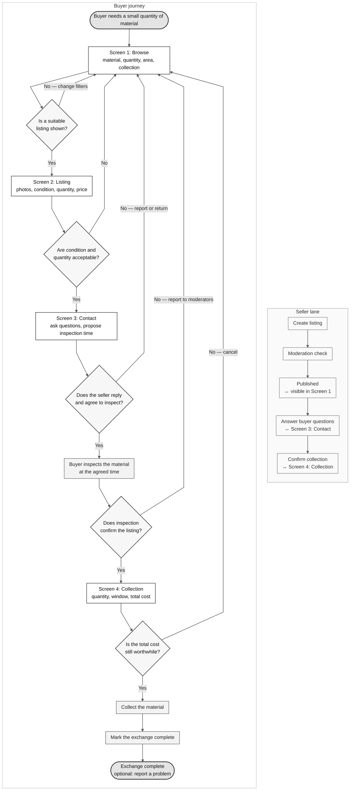

# JengaConnect — buyer journey flowchart

The source file is [`jengaconnect-flowchart.mmd`](jengaconnect-flowchart.mmd).

The chart is a greyscale `flowchart TD` with:

- rounded **Start** and **End** nodes;
- rectangles for **screens** and **actions**;
- diamonds for decisions, with **Yes** and **No** paths;
- loops back to **Screen 1: Browse** when a listing is unsuitable;
- a parallel **Seller** lane on the right for create → moderation → publish → answer → confirm;
- seller hand-offs marked on the three seller steps that touch the buyer journey.

## Mermaid source



## Export as an image

### Option A — Mermaid Live Editor

1. Open <https://mermaid.live>.
2. Paste the Mermaid source into the code panel.
3. Use **Actions → Download PNG** for a raster image, or **Download SVG** for a crisp, scalable image.
4. For A4 printing, open the SVG in a browser and print it as **A4 portrait** with **Fit to page** selected. The seller lane remains on the right.

### Option B — Mermaid CLI

The CLI needs Node.js. Run one of these from this folder:

```bash
# PNG, white background, large enough for print
npx @mermaid-js/mermaid-cli \
  -i jengaconnect-flowchart.mmd \
  -o jengaconnect-flowchart.png \
  -b white --size 1800

# SVG, best for editing and printing
npx @mermaid-js/mermaid-cli \
  -i jengaconnect-flowchart.mmd \
  -o jengaconnect-flowchart.svg \
  -b white
```

If Chromium refuses to start inside a container, add a Puppeteer config file:

```json
{ "args": ["--no-sandbox", "--disable-setuid-sandbox"] }
```

Then pass it with `-p puppeteer.json`.

### A4 print settings

- Paper: **A4 portrait**.
- Margins: **10 mm** or less.
- Scale: **Fit to page**.
- Background: **white**, so the greys stay clean.
- For a larger wall copy, print the same SVG on A3; the layout is vector-based.

## Editing the chart

- Change screen or action wording directly inside the square-bracket labels.
- Keep decisions in `{ ... }` and screens/actions in `[ ... ]`.
- To add a new loop, point a **No** arrow back to the relevant earlier node.
- To add another seller step, add it inside `Seller` and keep the chain `-->` intact.
